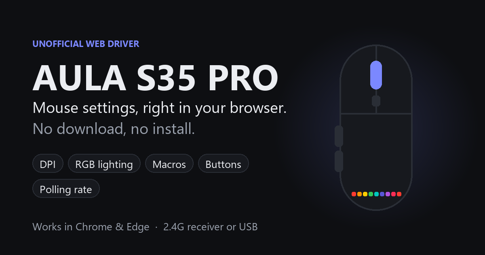

# AULA S35 PRO driver — online, no download

  

  <a href="https://sahajjain01.github.io/aula-s35pro-web/"><b>▶&nbsp;&nbsp;Open the app: sahajjain01.github.io/aula-s35pro-web</b></a>

Change the DPI, polling rate, buttons, macros and RGB lighting of your **AULA S35 PRO** gaming mouse straight from
your browser. Nothing to install: settings are saved on the mouse, so they work on any computer afterwards.

The official Windows installer for this mouse is called **AULA-S350PRO** (狼蛛AULA-S350PRO). This app does the same
job in Chrome or Edge, on Windows, macOS, Linux and ChromeOS.

## How to use it

1. Open **https://sahajjain01.github.io/aula-s35pro-web/** in **Chrome, Edge or Opera** on a computer.
2. Plug in the mouse's **2.4G receiver** or **USB cable**. Close the official AULA software if it's running.
3. Click **Connect mouse** and pick **“2.4G Gaming Mouse”** (or **“USB Gaming Mouse”**) in the browser prompt.
4. Change anything you like. Every change is saved to the mouse instantly.

No mouse handy? Click **Try the demo** to look around.

## What you can change

- **Buttons** – remap all six buttons and the scroll wheel: mouse clicks, any key or key combo, media keys,
  DPI / profile / lighting switching, horizontal scroll, shortcuts (copy, paste, show desktop …), double click,
  rapid fire and your own macros. Reset one button or all of them to factory functions.
- **DPI** – up to 8 stages from 100 to 12000 DPI, each with its own colour, plus the active stage.
- **Polling rate** – 125, 250, 500 or 1000 Hz, and debounce time.
- **Macros** – record keystrokes, clicks and scrolls with timing; play once, while held, or toggle.
- **RGB lighting** – all 9 effects with brightness, speed, direction and up to 7 colours; lights-off-while-moving.
- **Sensor and power** – angle snapping, ripple control, motion smoothing, sleep timers, wake on movement.
- **Profiles** – Office, Game I and Game II, with export, import and reset.

## FAQ

**Is this the official AULA software?** No. It's an independent open-source project that speaks the same
protocol as the official driver. It isn't affiliated with or endorsed by AULA.

**Why doesn't it work in Firefox or Safari?** Those browsers don't support WebHID, the browser feature that lets
a web page talk to USB devices.

**The mouse doesn't show up.** Close the official AULA software, click a mouse button to wake it (wireless), then
click Connect again. On Linux, give your user access to `hidraw` devices with a udev rule.

## For developers

Plain HTML/CSS/JS, no build step. Serve the folder with any static server (`python -m http.server`) and open it on
`localhost`. The reverse-engineered HID protocol is documented in [PROTOCOL.md](PROTOCOL.md);
`js/data.js` is generated from the official driver's `DeviceFeature.ini` (sensor DPI tables, lighting options).
